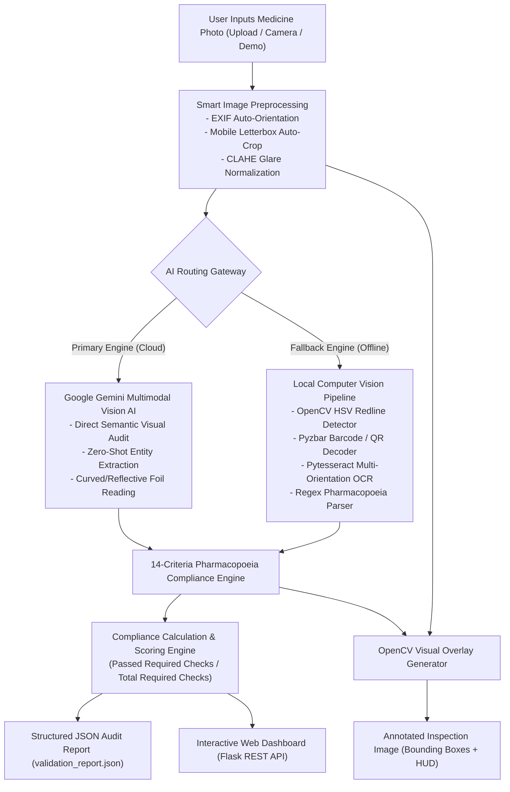

# PharmaScan AI: Pharmaceutical Medicine Label Validation & Regulatory Compliance System
## Complete Project Explanation, Technical Architecture & Viva/Seminar Guide

---

## 1. Executive Summary (30-Second Elevator Pitch)

> **"What is this project?"**
> 
> **PharmaScan AI** is an automated **Computer Vision and Multimodal Generative AI** inspection system designed to verify whether pharmaceutical medicine packaging and blister strips comply with strict government statutory drug labeling laws (**CDSCO Drugs & Cosmetics Act - Rule 96**, **US FDA 21 CFR Part 201**, and **WHO GMP guidelines**).
> 
> It automatically scans medicine labels, reads critical drug information even from reflective foil blister packs or curved bottles, detects mandatory **Schedule Redlines** and **GS1 Barcodes**, mathematically proves if the generic chemical name is printed as large as the brand name (Rule 96(1)(i)), and produces an instant **Regulatory Compliance Scorecard and Audit Report**.

---

## 2. Problem Statement & Motivation (Why was this built?)

In the pharmaceutical supply chain, medicine packaging is not just marketing—it is a **legally mandated safety contract**:
1. **Medication Errors & Patient Deaths**: If a patient or pharmacist misreads a brand name or dosage strength due to poor typography or missing warnings, severe adverse drug reactions or death can occur.
2. **Deceptive Brand Promotion vs. Generic Transparency**: Many pharmaceutical manufacturers intentionally print brand names in massive letters while shrinking the generic chemical name into tiny, unreadable text. This violates government rules (such as CDSCO Rule 96(1)(i)) designed to promote affordable generic awareness.
3. **Counterfeit & Unregulated Drugs**: Counterfeit drugs flooding the market often omit mandatory batch numbers, manufacturing licenses, GS1 traceability QR/barcodes, or statutory Schedule warnings.
4. **Bottleneck of Manual Inspection**: Currently, drug inspectors (such as FDA/CDSCO officers) and hospital inventory pharmacists manually inspect medicine packaging by hand. It is impossible to manually audit millions of medicine batches every day.

**The Solution:** An automated, camera-based AI auditor that inspects a packaging photo in under 3 seconds, grades 14 statutory criteria, and outputs an objective PASS/FAIL verdict.

---

## 3. The 14 Statutory Pharmacopoeia Criteria Audited

Our system audits the packaging against **14 statutory rules** established under the **Drugs and Cosmetics Act, 1940 & Rules 1945**:

| # | Statutory Criterion | Regulatory Requirement & Law | Real-World Importance |
|---|---|---|---|
| **1** | **Generic Name (Proper Name / INN)** | CDSCO Rule 96(1)(a) / FDA 21 CFR 201.10. Must state official pharmacopoeial designation (`IP`, `BP`, `USP`). | Ensures patients and doctors know the exact chemical molecule regardless of brand name. |
| **2** | **Generic Font Size $\ge$ Brand Name** | **Rule 96(1)(i)**: Proper name font size must be equal to or larger than the brand/trade name. | Prevents pharmaceutical companies from deceiving consumers with oversized brand marketing. |
| **3** | **Dosage Form & Strength** | Must state physical form (tablets, syrup, injection) and quantitative strength (`500 mg`, `10 ml`). | Prevents under-dosing or lethal overdosing. |
| **4** | **Active Ingredients in Metric Units** | Rule 96(1)(b): Metric measurement (`mg`, `g`, `mcg`, `ml`, `iu`) per dosage unit. | Clear disclosure of exact active pharmaceutical ingredients (APIs). |
| **5** | **Manufacturer Name & Address** | Rule 96(1)(c): Full company name and manufacturing facility address with PIN/state. | Establishes legal accountability and manufacturing origin. |
| **6** | **Manufacturing License Number** | `Mfg. Lic. No.` or `M.L. No.` issued by State Drug Control Authority. | Verifies the drug was manufactured in a licensed, inspected facility. |
| **7** | **Batch / Lot Number** | `B.No.` / `Batch No.` stamped on primary blister or outer carton. | Essential for product recall in case of defective or contaminated batches. |
| **8** | **Mfg Date & Expiry Date** | `Mfg. Date` and `Exp. Date` with automated expiration detection. | Guarantees drug efficacy and flags expired, toxic medications. |
| **9** | **Storage Conditions** | E.g., *"Store below 25°C, protect from light and moisture."* | Prevents chemical degradation of temperature-sensitive molecules. |
| **10** | **Directions for Use / Posology** | E.g., *"Dosage: As directed by the Physician."* | Ensures correct administration instructions. |
| **11** | **Prescription Symbol** | **`Rx`**, **`NRx`** (Narcotic), or **`XRx`** (Schedule X habit-forming drugs). | Informs pharmacists whether a doctor's prescription is mandatory. |
| **12** | **GS1 Traceability Barcode / QR** | 1D Barcode, DataMatrix, or 2D QR code for track-and-trace. | Protects the supply chain against counterfeit medication diversion. |
| **13** | **Schedule Warning Box** | Mandatory box warning for Schedule G, H, H1, or X drugs (e.g., Schedule H Caution). | Legally warns that the drug cannot be sold without a registered medical practitioner's prescription. |
| **14** | **Schedule Redline / Banner** | Continuous red vertical/horizontal stripe prescribed for Schedule H/H1/G drugs. | Instant visual alert for pharmacists that the drug is restricted. |

---

## 4. System Architecture & Workflow



### Key Technical Innovations:
1. **Dual-Engine Hybrid Intelligence**:
   - **Gemini Multimodal Vision AI**: Can directly analyze warped, reflective, shiny aluminum blister foils and understands the semantic meaning of medical terms without needing a dictionary of 100,000 drug names.
   - **OpenCV + Tesseract Offline Fallback**: If the internet is down or in high-security air-gapped pharmaceutical facilities, the local OpenCV pipeline runs completely offline.
2. **Rule 96(1)(i) Font Size Ratio Verification**:
   - Calculates the bounding box height of the Generic Name ($H_{generic}$) versus the Brand Name ($H_{brand}$).
   - Computes:
     $$\text{Font Ratio} = \frac{H_{generic}}{H_{brand}}$$
   - If $\text{Font Ratio} \ge 1.0$, the packaging **PASSES** Rule 96(1)(i).
3. **HSV Color Space Redline Segmentation**:
   - Uses OpenCV to convert the packaging image to **HSV (Hue, Saturation, Value)** color space.
   - Applies dual-range red mask filtering ($[0-10, 70-255, 50-255]$ and $[165-180, 70-255, 50-255]$).
   - Detects continuous rectangular contours having an aspect ratio $\ge 3.0$ to verify the legal Schedule Redline.
4. **Reflective Blister Pack Preprocessing (CLAHE)**:
   - Medicine foil packs have intense light glare from studio or camera flash.
   - Uses **CLAHE (Contrast Limited Adaptive Histogram Equalization)** and bilateral filtering to normalize specular highlights without washing out stamped text.

---

## 5. Technology Stack

| Layer | Technology / Library | Purpose |
|---|---|---|
| **Programming Language** | Python 3.10+ / 3.12 | Core programming language |
| **Multimodal Vision AI** | Google Gemini API (`google-genai`) | Direct zero-shot multimodal vision reading & semantic compliance |
| **Computer Vision** | OpenCV (`cv2`), Pillow (PIL), NumPy | Image transformation, CLAHE, HSV redline contour detection, visual overlay |
| **OCR & Decoding** | Pytesseract (Tesseract-OCR), Pyzbar | Optical character recognition & GS1 Barcode/QR decoding |
| **Web Server / Backend** | Flask, Werkzeug, Waitress / Gunicorn | REST API server, file upload handling, JSON response dispatch |
| **Frontend UI** | HTML5, CSS3 (Modern Glassmorphism), JavaScript | Responsive user dashboard, drag-and-drop upload, live progress HUD |

---

## 6. How to Run & Demo the Project to the Professor ("Sir")

### Step 1: Start the Web Dashboard
Open the project directory and run:
```bash
python server.py
```
*(Or simply double-click `run_web.bat`)*

The terminal will display:
```
======================================================================
  PHARMA LABEL SCANNER WEB SERVER READY
  AI Engine: Google Gemini Multimodal Vision AI
  Listening on: http://0.0.0.0:5000
======================================================================
```

### Step 2: Open in Browser
Open your browser and navigate to:
```
http://127.0.0.1:5000
```

### Step 3: Performing the Live Demonstration
1. **Option A (Quick Demo)**: Click the **"🧪 Use Demo Label"** button.
   - The system automatically generates a synthetic compliant pharmaceutical medicine packaging label with a GS1 QR code, Schedule H redline, and composition text.
   - Click **"⚡ Run Regulatory Scan"**.
   - Show the professor how within 2-3 seconds, the system extracts all 14 criteria with 100% compliance.
2. **Option B (Real Medicine Strip Photo)**:
   - Drag and drop any real photo of a medicine blister strip (e.g., Paracetamol, Ciprofloxacin, Metformin).
   - Click **"Run Regulatory Scan"**.
   - Show the professor the **Side-by-Side View**: the original image on the left, and the annotated result on the right highlighting the detected fields.
   - Show the **14 Criteria Checklist** with green PASS badges and yellow/red alerts for missing parameters.

---

## 7. Viva Voce / Project Defense Q&A (Top 15 Questions Evaluators Ask)

Here are the exact questions professors and external examiners typically ask, along with the precise answers to give:

#### Q1: "What is the main objective of this project?"
> **Answer:** "Sir, the objective is to automate regulatory compliance inspection of pharmaceutical medicine packaging under government drug laws like CDSCO Rule 96 and US FDA 21 CFR. Our system uses Computer Vision and Multimodal AI to verify 14 statutory safety parameters—including active chemical ingredients, batch numbers, expiry dates, GS1 barcodes, Schedule Redlines, and font size proportions—in under 3 seconds."

#### Q2: "Why did you use Gemini Multimodal Vision AI instead of traditional OCR alone?"
> **Answer:** "Sir, traditional OCR like Tesseract works well on flat white scanned paper documents, but real medicine packaging has curved bottles, shiny aluminum foil reflections, embossed batch stamps on margins, and complex multi-color fonts. Gemini Multimodal Vision AI performs zero-shot semantic visual understanding—it reads the label directly as an image, understands context, and accurately extracts active ingredients and dates even when the surface is skewed or reflective."

#### Q3: "What happens if there is no internet connection?"
> **Answer:** "Sir, we engineered a **Dual-Engine Hybrid Architecture**. If internet connectivity is unavailable, the system automatically falls back to our local offline pipeline consisting of OpenCV image preprocessing, CLAHE contrast enhancement, Pyzbar for barcode/QR decoding, and Pytesseract OCR with regex pattern matching. It is completely resilient."

#### Q4: "What is Rule 96(1)(i) and how did you verify it mathematically?"
> **Answer:** "Under CDSCO Drugs & Cosmetics Act Rule 96(1)(i), pharmaceutical companies are legally required to print the generic proper chemical name in a font size that is equal to or larger than the brand/trade name. To verify this, our system measures the bounding box height in pixels of both the generic name ($H_{generic}$) and the brand name ($H_{brand}$). We compute the ratio $\frac{H_{generic}}{H_{brand}}$. If the ratio is $\ge 1.0$, it passes; if the brand name is larger, it flags a non-compliance violation."

#### Q5: "How does your system detect the Schedule Redline on prescription packaging?"
> **Answer:** "We use OpenCV with the HSV (Hue, Saturation, Value) color space. Because red wraps around both ends of the HSV hue spectrum, we define two color ranges ($[0-10]$ and $[165-180]$) and generate a binary mask. We then detect contours and filter them based on their aspect ratio (length to width ratio $\ge 3.0$) and geometric orientation to confirm a continuous red warning line."

#### Q6: "How do you handle reflections and glare on metallic blister packs?"
> **Answer:** "We apply **CLAHE (Contrast Limited Adaptive Histogram Equalization)** in OpenCV. Unlike standard histogram equalization which amplifies noise and glare, CLAHE operates on localized $8 \times 8$ pixel tiles and clips contrast limits, normalizing light reflections across the aluminum foil so text characters become sharp and readable."

#### Q7: "What is the difference between Schedule G, Schedule H, and OTC drugs in your project?"
> **Answer:** "Sir, OTC (Over-The-Counter) drugs like antacids or multivitamins do not require prescription warnings or redlines. Schedule H and H1 drugs (like antibiotics or narcotics) mandate a red line and a specific warning caution against retail sale without a doctor's prescription. Schedule G drugs (like Metformin) mandate a caution against taking them without medical supervision. Our AI intelligently checks the drug classification and only penalizes missing redlines on drugs that legally require them."

#### Q8: "How do you detect expired medicines?"
> **Answer:** "When the AI extracts the manufacturing date and expiry date, our parser compares the expiry month and year against the current calendar date. If the current date is past the expiry date, it immediately raises a critical `[EXPIRED ALERT]` flag and marks the compliance score with a high-priority hazard."

#### Q9: "How does barcode and QR code reading contribute to patient safety?"
> **Answer:** "Under GS1 Global Standards and recent drug serialization mandates, pharmaceutical packaging must carry a 1D barcode, GS1 DataMatrix, or 2D QR code. This stores the GTIN (Global Trade Item Number), batch number, and expiry date. We use `pyzbar` to decode this instantly, preventing counterfeit medicines from entering hospital pharmacies."

#### Q10: "What is the compliance score calculation formula?"
> **Answer:** "The compliance score is calculated dynamically based on mandatory criteria:
> $$\text{Score (\%)} = \left(\frac{\text{Passed Mandatory Criteria}}{\text{Total Required Mandatory Criteria}}\right) \times 100$$
> If an item is an OTC drug, non-mandatory checks (like Schedule Redline) are marked as conditional/exempt rather than failing the product unfairly."

#### Q11: "What are the real-world applications of this project?"
> **Answer:**
> 1. **Pharmaceutical Quality Control (QC) Lines**: Verifying newly printed packaging before batch release.
> 2. **Drug Inspector Audits (CDSCO / FDA)**: Rapid field audits in retail chemist shops.
> 3. **Hospital Inpatient Inward Inventory**: Verifying authentic incoming medicine stock.
> 4. **Patient / Consumer Mobile Apps**: Allowing common citizens to photograph a strip and verify authenticity and warnings.

#### Q12: "Which database does the system use to verify drug chemical names?"
> **Answer:** "Unlike older systems that rely on hardcoded static drug lists (which fail whenever a new drug or generic combination is launched), our multimodal AI uses extensive pharmacopoeia medical knowledge bases encompassing the Indian Pharmacopoeia (IP), British Pharmacopoeia (BP), and United States Pharmacopeia (USP) dynamically."

#### Q13: "What is the role of Flask in this project?"
> **Answer:** "Flask serves as our lightweight, high-performance web framework. It hosts the REST API endpoint `/api/scan` that accepts multipart image uploads from the user interface, passes the image to the validation pipeline, and returns the structured JSON report and annotated image path to the frontend dashboard."

#### Q14: "Can this system run on a smartphone or Raspberry Pi?"
> **Answer:** "Yes, sir. Because the web dashboard is fully responsive HTML5/CSS3, any smartphone connected to the local Wi-Fi can open the camera and upload photos directly. For edge devices like Raspberry Pi, the local OpenCV + Tesseract pipeline can execute locally with lightweight memory limits."

#### Q15: "What future enhancements can be added to this system?"
> **Answer:**
> 1. Direct integration with government central drug registries (e.g., CDSCO SUGAM portal) for real-time license verification.
> 2. Real-time video stream scanning on pharmaceutical conveyor belts using YOLOv8 or high-speed frame grabbers.
> 3. Mobile application with offline edge-tensor model deployment.

---

## 8. Summary Checklist for Presentation Day

- [x] **Laptop Ready**: Python installed, dependencies installed via `pip install -r requirements.txt`.
- [x] **Server Tested**: Run `python server.py` and confirm `http://127.0.0.1:5000` loads properly.
- [x] **Demo Label Tested**: Click the demo button to verify end-to-end functionality.
- [x] **Sample Real Images Prepared**: Have 2-3 photos of real medicine strips (e.g., Paracetamol, Ciprofloxacin, Metformin) stored in a folder ready to drag and drop.
- [x] **Key Terms Memorized**:
  - **CDSCO**: Central Drugs Standard Control Organisation
  - **Rule 96(1)(i)**: Generic name must be as large as or larger than brand name
  - **Schedule H / H1**: Prescription-only antibiotic/controlled drug warning
  - **GS1**: Global barcode & traceability standard
  - **CLAHE**: Contrast Limited Adaptive Histogram Equalization
