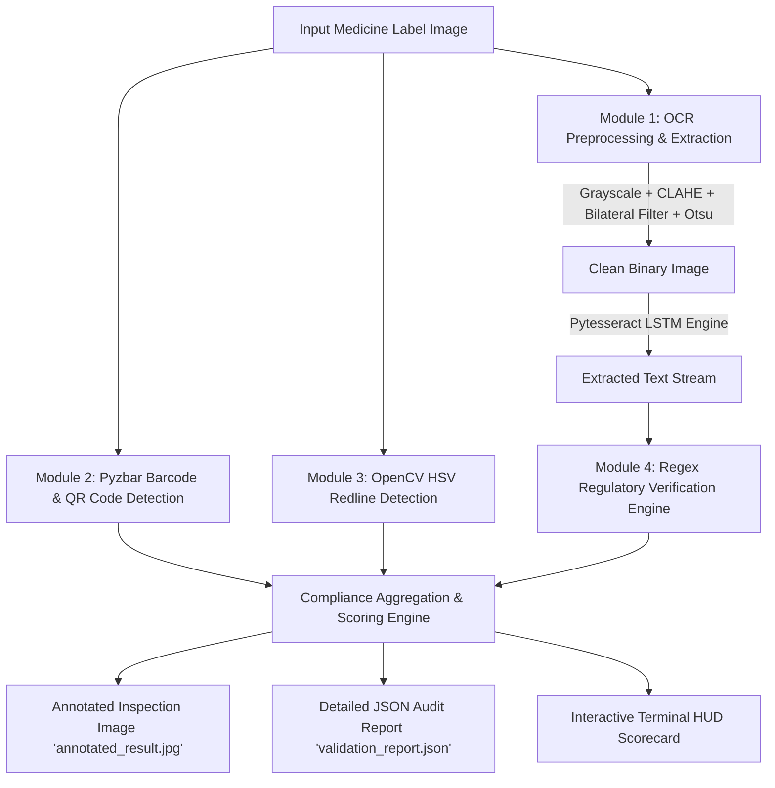

# Pharmaceutical Medicine Label Validation & Scanning System
*A Computer Vision & AI-Powered Drug Regulatory Compliance Inspection Project*

---

## 📌 Project Overview
In pharmaceutical manufacturing and distribution, statutory compliance with drug labeling standards (such as **CDSCO Drugs & Cosmetics Act**, **US FDA 21 CFR Part 201**, and **WHO GMP guidelines**) is critical to patient safety. Omission of critical details—such as batch numbers, expiry dates, or prescription warnings—can result in fatal medication errors, counterfeit distribution, or severe regulatory penalties.

This project delivers an automated computer vision and text mining system that verifies the authenticity, safety, and regulatory completeness of pharmaceutical packaging labels.

---

## 🛠️ System Architecture & Workflow



---

## ⚙️ Key Modules & Working Logic

### 1. Image Preprocessing & OCR Extraction (`cv2` & `pytesseract`)
- **CLAHE (Contrast Limited Adaptive Histogram Equalization)**: Normalizes uneven glare and ambient lighting across reflective foil or glossy blister packs.
- **Bilateral Filter (`cv2.bilateralFilter`)**: Smooths high-frequency sensor noise while preserving sharp character edges, outperforming standard Gaussian blur.
- **Otsu’s Thresholding (`cv2.threshold`)**: Automatically calculates the optimal threshold value to binarize text into high-contrast black-and-white.
- **Pytesseract Engine**: Configured with Page Segmentation Mode (PSM) 6 and OEM 3 (LSTM Neural Network) to recognize small print, dosage units, and chemical names.

### 2. Barcode & QR Code Identification (`pyzbar`)
- Decodes 1D serial barcodes (**EAN-13, Code 128**) and 2D **GS1 QR Codes / DataMatrix**.
- Verifies package serialization and batch traceability to prevent counterfeit drugs.

### 3. Prescription Redline Detection (OpenCV HSV Color Filtering)
- **Regulatory Rule**: Under **Schedule H / H1** regulations, drugs requiring a doctor's prescription must carry a prominent red vertical or horizontal line to alert pharmacists and consumers.
- **Why HSV over RGB/BGR?** RGB is highly susceptible to variations in room lighting and shadows. The **HSV (Hue, Saturation, Value)** color space separates color chromaticity (Hue) from brightness (Value).
- **Dual-Band Red Mask**: In OpenCV, Hue ranges from 0 to 180. Red wraps around the boundary (0°–10° and 170°–180°). Both ranges are filtered and combined via bitwise OR (`cv2.bitwise_or`).
- **Morphological Structuring**: Rectangular kernels (`25x3` and `3x25`) merge disjoint line pixels.
- **Aspect Ratio Filtering**: Distinguishes an actual continuous red line (aspect ratio $\ge 3.5$) from red logos or red typography.

### 4. 14 Statutory Pharmacopoeia Criteria Validation Engine
Scans and evaluates packaging against all 14 statutory criteria of Pharmacopoeia & Drug Packaging Regulations:
1. **Generic Name (Proper Name / INN)**: Standard pharmacopeial designations (IP, BP, USP) or known therapeutic compounds (e.g. *Ciprofloxacin Tablets IP*).
2. **Generic Name Font Size >= Brand Name (Rule 96(1)(i))**: Compares character bounding box heights to ensure generic name is at least as large (or 2 font sizes larger) than brand name.
3. **Dosage Form & Strength**: Matches quantitative concentrations (`500 mg`, `10 ml`, `w/v`) and dosage forms (`tablets`, `capsules`, `syrup`, `injection`).
4. **Active Ingredients in Metric Units**: Identifies `"Each film-coated tablet contains"` and verifies metric unit statements (`mg`, `g`, `mcg`, `ml`, `iu`).
5. **Name & Address of Manufacturer**: Detects `"Manufactured by:"` / `"Mfd by:"` with plant facility address and PIN code.
6. **Manufacturing License Number**: Checks for `"Mfg. Lic. No."`, `"M.L. No."`, `"Licence No."`.
7. **Batch / Lot Number**: Detects `"B.No."`, `"Batch No."`, `"Lot No."` (including vertical side-strip orientation).
8. **Mfg Date & Expiry Date**: Identifies `"Mfg. Date"`, `"Exp. Date"`, `"Best Before"`.
9. **Storage Conditions**: Verifies mandatory storage instructions (`"Store Protected from light and moisture"`, `"Store below 25°C"`).
10. **Directions for Use / Dosage**: Verifies posology and reference statements (`"Dosage: As directed by the Physician"`).
11. **Prescription Symbol (Rx, NRx, XRx)**: Detects mandatory prescription symbol in header/corner.
12. **Required Barcode or QR Code**: GS1 1D Barcode, DataMatrix, or 2D QR Code for traceability (mandatory on secondary carton / Top 300 formulations).
13. **Schedule & Warning Box**: Mandatory Schedule H/H1/X statutory warning box (`"Not to be sold by retail without the prescription of a Registered Medical Practitioner"`).
14. **Schedule Redline**: Prominent vertical/horizontal red strip on prescription drug packaging.

---

## 💻 Windows Setup & Installation Guide

### Step 1: Install Python (if not installed)
1. Download Python 3.10+ (64-bit) from [python.org](https://www.python.org/downloads/).
2. ⚠️ **Important**: During installation, check the box: **"Add Python to PATH"**.

### Step 2: Install Tesseract-OCR Engine on Windows
1. Download the Windows 64-bit installer from the UB-Mannheim repository:
   👉 [Tesseract at UB Mannheim GitHub](https://github.com/UB-Mannheim/tesseract/wiki)
2. Run the installer (recommended path: `C:\Program Files\Tesseract-OCR`).
3. The script `app.py` is programmed to **automatically search** this location.

### Step 3: Install Visual C++ Redistributable (Required for `pyzbar`)
`pyzbar` relies on a C++ library (`libzbar-64.dll`). If missing, download and install:
👉 [Microsoft Visual C++ 2015-2022 Redistributable (x64)](https://aka.ms/vs/17/release/vc_redist.x64.exe)

### Step 4: Install Python Dependencies
Open PowerShell or Command Prompt in the project folder and run:
```bash
pip install -r requirements.txt
```

---

## 🚀 How to Run the Project

### Option A: Interactive Web Application Dashboard (Recommended for College Presentations)
Launch the modern browser UI with drag-and-drop label upload, live scan progress, and side-by-side inspection cards:
```bash
run_web
```
*Or via Python:*
```bash
python server.py
```
Then open your browser at **`http://127.0.0.1:5000`** (opens automatically).

### Option B: Terminal CLI Quick Run
Run directly via the helper script:
```bash
run
```
Or scan your own medicine image:
```bash
run --image path/to/your/medicine_label.jpg
```

### Option C: Custom Output Names
```bash
python app.py --image medicine.jpg --output my_annotated_label.jpg --json my_audit_report.json
```

---

## 📊 Sample Output Preview

```
================================================================================
      PHARMACEUTICAL MEDICINE LABEL VERIFICATION REPORT
================================================================================
Target Image: sample_medicine_label.png
--------------------------------------------------------------------------------
1. BARCODE / QR CODE CHECK:        [PASS]
   - Status: Detected valid GS1 / 1D format.

2. SCHEDULE H REDLINE CHECK:       [PASS]
   - Status: PASS (Schedule Redline Present)
   - Strip #1: Horizontal orientation, Aspect Ratio: 34.2

3. MANDATORY REGULATORY CRITERIA (REGEX VERIFICATION):
┌────────────────────────────────┬──────────┬────────────────────────────────────┐
│ PARAMETER                      │ STATUS   │ EXTRACTED MATCH                    │
├────────────────────────────────┼──────────┼────────────────────────────────────┤
│ Brand & Generic Name           │ [PASS]   │ CIPROLET - 500 Ciprofloxacin...    │
│ Dosage Form & Strength         │ [PASS]   │ 500 mg, Tablets                    │
│ Active Ingredients / Composit. │ [PASS]   │ Each film-coated tablet contai...  │
│ Batch / Lot Number             │ [PASS]   │ B.No.: B-84920                     │
│ Manufacturing Date             │ [PASS]   │ Mfg. Date: 04/2024                 │
│ Expiry Date                    │ [PASS]   │ Exp. Date: 03/2027                 │
│ Manufacturing License Number   │ [PASS]   │ Mfg. Lic. No.: M/849/2019          │
│ Storage Conditions             │ [PASS]   │ Store in a cool, dry place...      │
│ Directions for Use / Dosage    │ [PASS]   │ Dosage: As directed by the Phys... │
│ Prescription Symbol / Warnings │ [PASS]   │ Rx, SCHEDULE H PRESCRIPTION...     │
└────────────────────────────────┴──────────┴────────────────────────────────────┘

================================================================================
OVERALL COMPLIANCE SCORE:  100.0% (9/9 mandatory fields)
FINAL AUDIT VERDICT:       COMPLIANT / PASS
================================================================================
```

---

## 🎓 College Presentation & Viva Questions

### Q1: Why did you use HSV rather than RGB for Redline detection?
> **Answer**: RGB values are strongly coupled with lighting intensity; shadows or bright flash reflections distort R, G, and B simultaneously. The HSV space separates pure color wavelength (**Hue**) from color purity (**Saturation**) and ambient brightness (**Value**). This makes color segmentation robust against varying lighting conditions.

### Q2: Why does red require two ranges in OpenCV HSV?
> **Answer**: The Hue wheel in OpenCV is represented from 0° to 180°. Pure red is located at 0° (and 360° in standard 360° color wheels). As a result, the red spectrum wraps around both the start ($0^\circ - 10^\circ$) and the end ($170^\circ - 180^\circ$) of the range. We must create two separate masks and unite them with bitwise OR.

### Q3: How do you differentiate a Schedule H red line from red text or a company logo?
> **Answer**: By computing the **aspect ratio** ($\text{width} / \text{height}$) and **minimum length** of the detected contour bounding boxes. A regulatory warning strip is an elongated horizontal or vertical band (aspect ratio $\ge 3.5$ and length spanning a significant portion of the label), whereas logos or letters have square/compact aspect ratios and smaller areas.

### Q4: How does your preprocessing pipeline improve OCR accuracy?
> **Answer**: Blister foils and medicine labels are prone to specular reflections and glare. Applying **CLAHE** equalizes local contrast without overamplifying background noise. The **Bilateral Filter** removes surface texture while preserving sharp character contours, enabling **Otsu’s binarization** to produce a crisp black-and-white mask for Tesseract’s LSTM engine.
