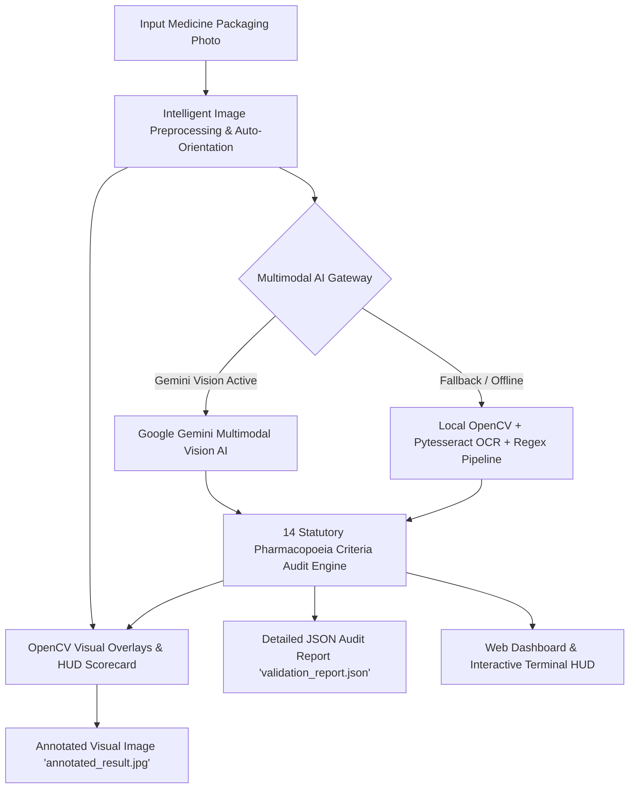

# Pharmaceutical Medicine Label Validation & Scanning System
*A Computer Vision & Multimodal AI-Powered Drug Regulatory Compliance Inspection Project*

---

## 📌 Project Overview
In pharmaceutical manufacturing and distribution, statutory compliance with drug labeling standards (such as **CDSCO Drugs & Cosmetics Act (Rule 96)**, **US FDA 21 CFR Part 201**, and **WHO GMP guidelines**) is critical to patient safety. Omission of critical details—such as batch numbers, expiry dates, or prescription warnings—can result in fatal medication errors, counterfeit distribution, or severe regulatory penalties.

This project delivers an automated **Multimodal Vision AI + Computer Vision** system that verifies the authenticity, safety, and regulatory completeness of pharmaceutical packaging labels.

---

## 🛠️ System Architecture & Workflow



---

## ⚙️ Key Modules & Working Logic

### 1. Google Gemini Multimodal Vision AI Engine (`gemini_validator.py`)
- **Semantic Packaging Comprehension**: Directly inspects the packaging image, reading complex fonts, skewed angles, foil reflections, and curved bottles.
- **Universal Drug Recognition**: Recognizes *any* brand name and *any* generic chemical compound without hardcoded lists.
- **Rule 96(1)(i) Font Comparison**: Evaluates whether the proper (generic) name is printed in a font size equal to or larger than the brand name.
- **Automatic Fallback Hierarchy**: Queries `gemini-3.5-flash-lite`, `gemini-3.1-flash-lite`, `gemini-3.8-flash` in sequence with automatic retry.

### 2. Local Fallback & Image Preprocessing Pipeline (`app.py`)
- **Smartphone EXIF Auto-Orientation**: Handles phone camera orientation metadata automatically.
- **CLAHE & Bilateral Filtering**: Normalizes glare across reflective foil blister packs.
- **HSV Redline & Pyzbar Detection**: Augments visual bounding boxes on annotated output.

### 3. 14 Statutory Pharmacopoeia Criteria Evaluated
1. **Generic Name (Proper Name / INN)**: Pharmacopeial designations (IP, BP, USP) and therapeutic compounds.
2. **Generic Name Font Size >= Brand Name (Rule 96(1)(i))**: Proper name prominence over brand name.
3. **Dosage Form & Strength**: Quantitative concentration (`500 mg`, `10 ml`, etc.) and dosage form.
4. **Active Ingredients in Metric Units**: Statement of active composition in metric units (`mg`, `g`, `mcg`, `ml`, `iu`).
5. **Name & Address of Manufacturer**: Name and manufacturing plant facility with PIN/state.
6. **Manufacturing License Number**: (`Mfg. Lic. No.`, `M.L. No.`, etc.).
7. **Batch / Lot Number**: (`B.No.`, `Batch No.`, `Lot No.`).
8. **Mfg Date & Expiry Date**: (`Mfg. Date`, `Exp. Date`, `Best Before`) with expired batch detection.
9. **Storage Conditions**: Temperature and moisture protection instructions.
10. **Directions for Use / Dosage**: Posology and reference statements.
11. **Prescription Symbol (Rx, NRx, XRx)**: Mandatory prescription symbol detection.
12. **Required Barcode or QR Code**: GS1 1D Barcode, DataMatrix, or 2D QR Code.
13. **Schedule & Warning Box**: Mandatory Schedule H/H1/X statutory warning box.
14. **Schedule Redline**: Prominent vertical/horizontal red strip on prescription drug packaging.

---

## 🚀 How to Run the Project

### Option A: Interactive Web Application Dashboard (Recommended)
Launch the modern browser UI with drag-and-drop label upload, live scan progress, and side-by-side inspection cards:
```bash
python server.py
```
*(Or double-click `run_web.bat`)*

Then open your browser at **`http://127.0.0.1:5000`**.

### Option B: Terminal CLI Quick Run
- **Scan demo label:**
  ```bash
  python app.py --demo
  ```
  *(Or run `run.bat`)*

- **Scan any real medicine photo:**
  ```bash
  python app.py --image path/to/your/medicine_label.jpg
  ```

---

## 📊 Sample Output Preview

```
================================================================================
      PHARMACEUTICAL MEDICINE LABEL VERIFICATION REPORT
================================================================================
AI Engine: Google Gemini Multimodal Vision AI (gemini-3.5-flash-lite)
Target Image: sample_medicine_label.png
--------------------------------------------------------------------------------
1. BARCODE / QR CODE CHECK:        [PASS] GS1 QR CODE
2. SCHEDULE H REDLINE CHECK:       [PASS] Schedule Redline Present
3. MANDATORY REGULATORY CRITERIA (14 STATUTORY RULES):
   - Generic Name:                 [PASS] CIPROFLOXACIN TABLETS IP 500MG
   - Rule 96(1)(i) Font Size:      [PASS] Generic is larger than Brand
   - Dosage Form & Strength:       [PASS] Tablets 500mg
   - Active Ingredients:           [PASS] Ciprofloxacin Hydrochloride IP eq. 500mg
   - Manufacturer:                 [PASS] CADILA PHARMACEUTICALS LIMITED
   - Mfg Lic No:                   [PASS] JK/01/06-07/110
   - Batch / Lot No:               [PASS] JKBD26020
   - Mfg & Exp Dates:              [PASS] MFG: FEB 2026 | EXP: JAN 2029
   - Storage Conditions:           [PASS] Store below 25°C, protect from moisture
   - Schedule Warning:             [PASS] SCHEDULE H PRESCRIPTION DRUG - CAUTION...
================================================================================
OVERALL COMPLIANCE SCORE:  100.0% (12/12 mandatory criteria)
FINAL AUDIT VERDICT:       COMPLIANT / PASS
================================================================================
```
