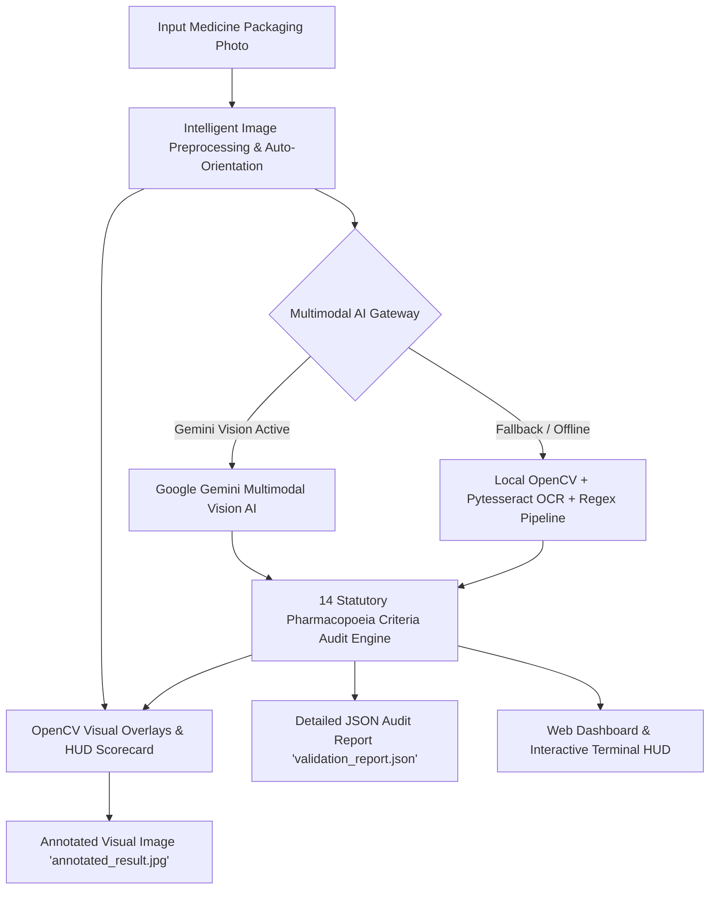

# Pharmaceutical Medicine Label Validation & Scanning System
*A Computer Vision & Multimodal AI-Powered Drug Regulatory Compliance Inspection Project*

---

## 📌 Project Overview
In pharmaceutical manufacturing and distribution, statutory compliance with drug labeling standards (such as **CDSCO Drugs & Cosmetics Act (Rule 96)**, **US FDA 21 CFR Part 201**, and **WHO GMP guidelines**) is critical to patient safety. Omission of critical details—such as batch numbers, expiry dates, or prescription warnings—can result in fatal medication errors, counterfeit distribution, or severe regulatory penalties.

This project delivers an automated **Multimodal Vision AI + Computer Vision** system that verifies the authenticity, safety, and regulatory completeness of pharmaceutical packaging labels.

---

## 🛠️ System Architecture & Workflow

### Current OCR implementation

**PaddleOCR is the default OCR engine.** Install `requirements.txt`; PP-OCRv5
mobile detection and recognition models download on first use. Set
`PADDLE_MODEL=server` for the larger PP-OCRv5 models. Text-region coordinates and
confidence are retained in reports. A separate Tesseract sparse-text pass measures
individual word heights for the generic-versus-brand font check only; its text
is not merged into the other criteria. `font_regions.py` first pairs generic and
brand headings on the same panel and re-reads those crops. Character components
inside recognized words exclude surrounding foil noise and trademark padding.
A colored-text search can recover a brand missed by Paddle. Measurements and
source boxes are retained in `font_ratio_analysis.measurement_evidence`.
The whole-page Tesseract pass remains a fallback when heading crops cannot be matched.
Run `python audit_font_measurements.py` to repeat the nine-photo font audit using
saved Paddle evidence, without rerunning the unrelated OCR criteria. Missing or unreliable measurements
fail the font check. This compares pixel heights, not certified typographic point sizes.
`PADDLE_MAX_SIDE` defaults to 2000 and `PADDLE_CPU_THREADS` defaults to 4.
Cached model directories are used directly so an unavailable model host does not
force a fallback when the files are already present.
If PaddleOCR cannot run or returns no text, Tesseract is used with a report warning.
`field_recovery.py` uses PP-OCRv6 medium on targeted stamp/manufacturer crops
when those fields are missing. This requires PaddleOCR 3.7+ (`pip install -r
requirements.txt`). The additional models download on first use unless cached.
Blue-ink localization recovers missed sideways stamps; original and filtered
readings remain attached as crop evidence. Set `OCR_FIELD_RECOVERY=0` to disable
this additional pass. It increases processing time and model memory usage.
A visual warning fallback detects a red panel with multiple printed text rows;
its result explicitly says the wording was not verified. A solid red rectangle
or one-line brand badge alone does not satisfy that fallback.
`OCR_ENGINE=tesseract` explicitly selects the older pipeline; `OCR_ENGINE=auto`
retains the legacy Tesseract-first supplement behavior. `ocr_engine` reports the
primary engine actually used. PaddleOCR requires more memory than Tesseract;
the existing free-tier deployment configuration must be capacity-tested.

The following describes the Tesseract fallback pipeline:

The current pipeline is implemented in `ocr_pipeline.py` and `label_fields.py`.
It preserves images up to 4800 pixels on the longest side for OCR, corrects uneven
illumination before thresholding, and uses the red channel to read black print on
red warning panels. Grayscale and sparse-text passes complement those readings.
Text is grouped using block, paragraph, and line identifiers, and competing
readings of the same spatial line are retained as alternatives rather than
concatenated into a noisy text stream. Field extraction respects section boundaries.

Reports include `ocr_lines` (text, confidence, coordinates, source, alternatives)
and per-field `diagnostic_notes` (also exposed as `review_notes` for compatibility).
Checks now use binary presence scoring: extracted text passes, missing content
fails. Low confidence, incomplete content and alternate readings remain diagnostic
notes and do not change a presence PASS. PASS therefore means content was detected,
not that every character or required subpart has been verified. Font comparison
still requires measured generic and brand heights; unavailable measurements fail.
Redline checks pass when detected and fail otherwise. Rx and barcode/QR checks
are optional: detected content passes; missing content displays OPTIONAL. The overall
verdict passes only when all mandatory checks pass; optional checks remain outside
the mandatory score. There is no manual-review status.
Composition spelling corrections use close OCR matches and the generic name read
elsewhere on the same label, preserve quantities, and retain `raw_extracted_value`.
A targeted glyph crop also handles stylized Rx symbols misread as IX in headers.
OCR confidence is an engine score, not a calibrated probability of correctness.
Detected codes do not establish GS1 validity or product authenticity. The score
counts confirmed passes among 12 required checks; 14 checks are displayed in total.

To diagnose a real image:

```bash
python debug_ocr.py static/uploads/test2.jpeg
python -m unittest -v test_label_validation
```

The diagnostic script writes `ocr_debug.txt` and `ocr_debug.json`. `OCR_MAX_DIM`
controls the maximum OCR image size (default 4800), `OCR_PASS_TIMEOUT` limits each
Tesseract pass (default 45 seconds), and `OCR_ROTATION_PASSES=0` disables supplemental
sideways scans. Retaining more pixels and running several passes costs time and
memory; deployment capacity should be measured with representative photos.
`OCR_ENGINE=auto` enables the legacy PaddleOCR supplement.
The older preprocessing diagram and sample output below describe the original
implementation and are not an exact description of these current settings.



---

## ⚙️ Key Modules & Working Logic

### 1. Google Gemini Multimodal Vision AI Engine (`gemini_validator.py`)
- **Semantic Packaging Comprehension**: Directly inspects the packaging image, reading complex fonts, skewed angles, foil reflections, and curved bottles.
- **Universal Drug Recognition**: Recognizes *any* brand name and *any* generic chemical compound without hardcoded lists.
- **Rule 96(1)(i) Font Comparison**: Evaluates whether the proper (generic) name is printed in a font size equal to or larger than the brand name.
- **Automatic Fallback Hierarchy**: Queries `gemini-3.5-flash-lite`, `gemini-3.1-flash-lite`, `gemini-3.8-flash` in sequence with automatic retry.

### 2. Local Fallback & Image Preprocessing Pipeline (`app.py`)
- **Smartphone EXIF Auto-Orientation**: Handles phone camera orientation metadata automatically.
- **CLAHE & Bilateral Filtering**: Normalizes glare across reflective foil blister packs.
- **HSV Redline & Pyzbar Detection**: Augments visual bounding boxes on annotated output.

### 3. 14 Statutory Pharmacopoeia Criteria Evaluated
1. **Generic Name (Proper Name / INN)**: Pharmacopeial designations (IP, BP, USP) and therapeutic compounds.
2. **Generic Name Font Size >= Brand Name (Rule 96(1)(i))**: Proper name prominence over brand name.
3. **Dosage Form & Strength**: Quantitative concentration (`500 mg`, `10 ml`, etc.) and dosage form.
4. **Active Ingredients in Metric Units**: Statement of active composition in metric units (`mg`, `g`, `mcg`, `ml`, `iu`).
5. **Name & Address of Manufacturer**: Name and manufacturing plant facility with PIN/state.
6. **Manufacturing License Number**: (`Mfg. Lic. No.`, `M.L. No.`, etc.).
7. **Batch / Lot Number**: (`B.No.`, `Batch No.`, `Lot No.`).
8. **Mfg Date & Expiry Date**: (`Mfg. Date`, `Exp. Date`, `Best Before`) with expired batch detection.
9. **Storage Conditions**: Temperature and moisture protection instructions.
10. **Directions for Use / Dosage**: Posology and reference statements.
11. **Prescription Symbol (Rx, NRx, XRx)**: Mandatory prescription symbol detection.
12. **Required Barcode or QR Code**: GS1 1D Barcode, DataMatrix, or 2D QR Code.
13. **Schedule & Warning Box**: Mandatory Schedule H/H1/X statutory warning box.
14. **Schedule Redline**: Prominent vertical/horizontal red strip on prescription drug packaging.

---

## 🚀 How to Run the Project

### Option A: Interactive Web Application Dashboard (Recommended)
Launch the modern browser UI with drag-and-drop label upload, live scan progress, and side-by-side inspection cards:
```bash
python server.py
```
*(Or double-click `run_web.bat`)*

Then open your browser at **`http://127.0.0.1:5000`**.

### Option B: Terminal CLI Quick Run
- **Scan demo label:**
  ```bash
  python app.py --demo
  ```
  *(Or run `run.bat`)*

- **Scan any real medicine photo:**
  ```bash
  python app.py --image path/to/your/medicine_label.jpg
  ```

---

## 📊 Sample Output Preview

```
================================================================================
      PHARMACEUTICAL MEDICINE LABEL VERIFICATION REPORT
================================================================================
AI Engine: Google Gemini Multimodal Vision AI (gemini-3.5-flash-lite)
Target Image: sample_medicine_label.png
--------------------------------------------------------------------------------
1. BARCODE / QR CODE CHECK:        [PASS] GS1 QR CODE
2. SCHEDULE H REDLINE CHECK:       [PASS] Schedule Redline Present
3. MANDATORY REGULATORY CRITERIA (14 STATUTORY RULES):
   - Generic Name:                 [PASS] CIPROFLOXACIN TABLETS IP 500MG
   - Rule 96(1)(i) Font Size:      [PASS] Generic is larger than Brand
   - Dosage Form & Strength:       [PASS] Tablets 500mg
   - Active Ingredients:           [PASS] Ciprofloxacin Hydrochloride IP eq. 500mg
   - Manufacturer:                 [PASS] CADILA PHARMACEUTICALS LIMITED
   - Mfg Lic No:                   [PASS] JK/01/06-07/110
   - Batch / Lot No:               [PASS] JKBD26020
   - Mfg & Exp Dates:              [PASS] MFG: FEB 2026 | EXP: JAN 2029
   - Storage Conditions:           [PASS] Store below 25°C, protect from moisture
   - Schedule Warning:             [PASS] SCHEDULE H PRESCRIPTION DRUG - CAUTION...
================================================================================
OVERALL COMPLIANCE SCORE:  100.0% (12/12 mandatory criteria)
FINAL AUDIT VERDICT:       COMPLIANT / PASS
================================================================================
```

---

## 🎓 College Presentation & Viva Questions

### Q1: Why did you use HSV rather than RGB for Redline detection?
> **Answer**: RGB values are strongly coupled with lighting intensity; shadows or bright flash reflections distort R, G, and B simultaneously. The HSV space separates pure color wavelength (**Hue**) from color purity (**Saturation**) and ambient brightness (**Value**). This makes color segmentation robust against varying lighting conditions.

### Q2: Why does red require two ranges in OpenCV HSV?
> **Answer**: The Hue wheel in OpenCV is represented from 0° to 180°. Pure red is located at 0° (and 360° in standard 360° color wheels). As a result, the red spectrum wraps around both the start ($0^\circ - 10^\circ$) and the end ($170^\circ - 180^\circ$) of the range. We must create two separate masks and unite them with bitwise OR.

### Q3: How do you differentiate a Schedule H red line from red text or a company logo?
> **Answer**: By computing the **aspect ratio** ($\text{width} / \text{height}$) and **minimum length** of the detected contour bounding boxes. A regulatory warning strip is an elongated horizontal or vertical band (aspect ratio $\ge 3.5$ and length spanning a significant portion of the label), whereas logos or letters have square/compact aspect ratios and smaller areas.

### Q4: How does your preprocessing pipeline improve OCR accuracy?
> **Answer**: Blister foils and medicine labels are prone to specular reflections and glare. Applying **CLAHE** equalizes local contrast without overamplifying background noise. The **Bilateral Filter** removes surface texture while preserving sharp character contours, enabling **Otsu’s binarization** to produce a crisp black-and-white mask for Tesseract’s LSTM engine.


## Testing the supplied medicine photographs

```bash
python audit_testing_images.py
python -m unittest -v test_label_validation
```

The batch command scans every JPEG in `static/uploads/TestingMedicineLabels` and
writes full OCR evidence and all 14 checks to `testing_results/latest`. The
November 2026 audit's baseline and revised reports are in `testing_results/baseline`
and `testing_results/final`. `testing_results/visual_reference.json` contains the
independently inspected photo reference; it is never loaded by the application.
Run `python compare_testing_results.py` to regenerate the comparison and detailed
`testing_results/audit_report.txt` for those saved baseline/final reports. `--revalidate` first reruns field parsing
against the saved final OCR regions without rerunning OCR.

A field that OCR cannot extract now produces **REVIEW**, with "Not detected in this
image", rather than establishing physical absence or rejecting the label.
Optional Rx/barcode checks remain conditional when not detected. An isolated
`R$` reading is retained as an uncertain Rx candidate, not silently corrected.
The overall pass requires all required checks to pass; the score is evidence
coverage and does not certify regulatory compliance. The supplied photos do not
establish performance on unseen packaging.

QR presence now requires decoded evidence or three finder patterns checked for
geometry and pixel structure. Generic headings, separated composition quantities,
manufacturer columns, concatenated batch/date labels, and numeric versus named
months have dedicated parsing handling. Font-size compliance, unreadable
characters, incomplete ingredients and non-metric enzyme activity still need
review. A detected field is not a guarantee that every transcribed character is
correct: consult the full audit report for remaining errors.
